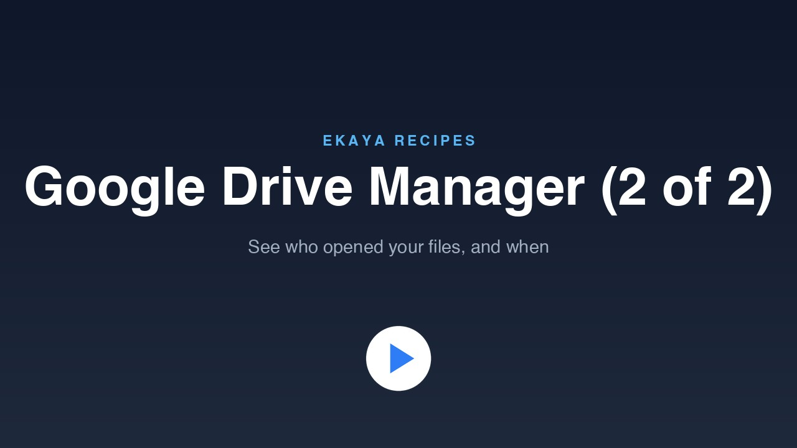

# Google Drive Manager (2 of 2): Viewing the Access Log

Add an Access log tab to your Google Drive Manager. It shows who other than you opened which files, read from your Google Workspace audit log: views, downloads, and files an app read on someone's behalf.

[](https://cdn.ekaya.ai/recipes/google-drive-manager-access-log.mp4)

[Watch the video](https://cdn.ekaya.ai/recipes/google-drive-manager-access-log.mp4), about two minutes long, or [watch it in full resolution](https://cdn.ekaya.ai/recipes/google-drive-manager-access-log-1080p.mp4).

## Before you start

- Finish [Google Drive Manager (1 of 2)](../google-drive-manager-permissions/). You then have the Google Drive Manager app.
- You must be an Administrator of your Ekaya project and a Google Workspace administrator. Google gives the audit log only to Workspace administrators, so a personal Google account cannot use this recipe.
- Have a Google Cloud project in the same Workspace organization, and Python 3 on your computer. The sign-in script uses only what Python includes.
- Prepare Google Cloud. In the Google Cloud console, on that project:
  1. Enable the **Admin SDK API**: **APIs & Services**, then **Library**.
  2. Open **Google Auth platform**, then **Branding**. If it says the platform is not configured, choose **Get Started**, give an app name and your email, set **Audience** to **Internal**, and finish. If the project already has a consent screen, open **Audience** first and check that it says **Internal**. Do not change an existing **External** audience: use a different project instead.
  3. Open **Google Auth platform**, then **Clients**, then **Create client**. Choose the application type **Desktop app**, give it any name, and choose **Create**. Then choose **Download JSON** right away: Google may not show the secret again.
  4. Note the project ID.

  The client file you downloaded is a secret. Do not paste it into the conversation, and delete it when you are done.

## What you will do

1. Do the Google Cloud steps above.
2. Paste the prompt below into your agent.
3. Your agent creates a connection and a link to its credential page. It then runs a small sign-in script on your computer. The script opens your browser: sign in as the Workspace administrator and approve read-only access to the audit log.
4. Copy four values into the credential page: the client ID, the client secret, the refresh token and the project ID. Never put them in the conversation. On a Mac, your agent gives you one command per value that copies it to the clipboard without printing it. On other systems, open the file the script saved in a text editor.
5. Your agent publishes the connector, tests it on your real log, and turns on the tab.
6. Open the app, choose **Access log**, and click **Load access log**.

## What the Access log shows

- People other than you, grouped by person. Each person expands to the files they opened, with the file's owner, its sharing level, what happened and when.
- Views, downloads, and **Read by an app**: an application, for example an AI assistant connected to someone's Drive, opened the file on that person's behalf.
- Flags for people outside your domain, for files shared externally, and for files shared with "anyone with the link".
- A choice of the last 30 days, 90 days or 6 months, and of which kinds of access to include. You can search by person, file or owner.
- A group called **Not identified**. It holds accesses Google records without a person, typically someone opening a file shared with "anyone with the link" while signed out.

Your own activity is left out.

## Why you sign in separately

The Drive connection in part 1 signs in with one click. The audit log is a different Google service, meant for administrators, and it is not part of that connection. Ekaya's custom connections also cannot sign in directly with Google. So this connection stores a Google sign-in that can only read the audit log (the `admin.reports.audit.readonly` scope). You sign in once. It is read-only and cannot change anything in Drive.

The script deliberately does not use `gcloud`'s own login, because `gcloud` insists on a much broader permission.

## Things to know

- The log appears a few minutes after an event, or later. In testing, a view by an outside account showed up about five minutes later. Do not expect it to be instant.
- Google keeps only recent history. The longest period the tab offers is six months.
- Events are listed from your whole Workspace domain, not only files you own. The Owner column shows a person or a shared drive name.
- A person with a plain personal Google account who views a shared file does appear, flagged as outside your domain.
- Only views, downloads and app reads are shown. Edits and sharing changes are not shown in this tab.
- The refresh token is stored in Ekaya's connection secrets, and it can only read the audit log.
- The first load of a six-month period can take up to about twenty seconds. If the period holds too many events, the tab asks you to choose a shorter one.
- When you are done, delete the client file and the file the sign-in script saved. Your agent can give you the exact commands.
- If Google ever stops accepting the stored token, for example after it is revoked, run the sign-in again and re-enter the values.

## Prompt

```text
Add the Access log to my Google Drive Manager using this Recipe:
https://github.com/ekaya-inc/ekaya-recipes/tree/main/applications/google-drive-manager-access-log
You may create a connection for my Google Workspace audit log,
run the sign-in script from this Recipe on my computer (it opens
my browser and saves a private file on my computer), publish the
connector, approve its read-only Request, and update the app to
show the tab. Never ask me to paste the client file, the secret
or the token into this conversation.
```

## For your agent

These steps are for the AI agent that the prompt was pasted into. They assume that Ekaya's MCP server is connected and that the person is an Administrator of the project and a Google Workspace administrator.

1. **Check part 1.** Call `describe_project` and `list_apps`: the app `google-drive-manager` must exist (part 1). Ask the person for the Google Cloud project ID and the path of the downloaded client JSON file. Never open or print that file.

2. **Create the connection.** Call `create_service_datasource` with name `Google Workspace audit log`, provider `custom`, a label, and credentials equal to the four in `connector/manifest.json`: `GOOGLE_CLIENT_ID`, `GOOGLE_CLIENT_SECRET` and `GOOGLE_REFRESH_TOKEN` as secrets, and `GOOGLE_QUOTA_PROJECT` not secret.

   - Do not declare `auth` or OAuth. A Custom connection can only use Ekaya's own sign-in server, a direct Google sign-in is refused (`scope_not_permitted`), and a datasource declared with OAuth cannot be converted afterwards.
   - It returns a single-use `human_link`. `request_connection_link` makes a new one if it expires. Create the link only right before the person needs it.

3. **Sign in.** Tell the person what the script does, then run `connector/signin.py` with `python3 -I`, with the arguments `CLIENT_JSON OUTPUT_JSON`. Put `OUTPUT_JSON` in a private folder under their home directory. The script writes it with mode 0600 and prints only the account email and the granted scopes, never a token. It opens their browser: they sign in as the Workspace administrator and approve. The granted scopes must be only `openid`, `userinfo.email` and `admin.reports.audit.readonly`. Do not use `gcloud auth application-default login`: it demands the broad `cloud-platform` scope.

4. **Enter the values.** The person pastes the values into the credential page. On macOS, give them one command per value that copies it without printing it:

   `python3 -I -c "import json,sys; sys.stdout.write(json.load(open(sys.argv[1]))[sys.argv[2]])" OUTPUT_JSON client_id | pbcopy`

   Then the same with `client_secret` and with `refresh_token`. They type the project ID. Wait for them. `get_datasource_connection` can show every credential as not present for a per-user connection even when it works: the real check is step 7.

5. **Publish the connector.** Call `publish_module_version` with the `datasource_id`, runtime `python3.12-2027.01`, `manifest` = `connector/manifest.json`, and `source` = `connector/google_drive_audit.py`. The connection must allow the AI agent to build and try actions. Publishing suggests one Request, `drive_access_events`.

6. **Approve the Request.** Review the suggested Request, then approve it with `approve_query_suggestion` and `effect_attestation` `READ`.

7. **Test it.** Call `execute_approved_request` on it with `start_time` six months ago (RFC 3339), `events` set to `view`, and `exclude_actor` set to the person's own email. Expect rows or an empty list, not an error. The error "Google refused the stored refresh token" means the values were pasted wrong or the token was revoked: call `request_connection_link` with `reconnect` true and have them re-enter the values.

8. **Turn on the tab.** Republish the part 1 app with `publish_app_version`: slug `google-drive-manager`, `base_version_id` the current version, `strict_recording` true, `requests` = the existing eight plus this Request's id, a file `access-log.js` (from this recipe's `app/` folder), and one edit on `index.html` that replaces `audit: ""` with `audit: "<this Request id>"`. The page then shows the Access log tab. Without the id and the file, the tab stays hidden.

9. **Hand over.** Tell the person to open the app, choose **Access log** and click **Load access log**. Explain **Not identified** and **Read by an app** in one sentence each.

10. **Clean up.** With the person's consent, delete the client JSON file and `OUTPUT_JSON` with `rm`. Remind them that the refresh token lives in the connection until it is revoked.
