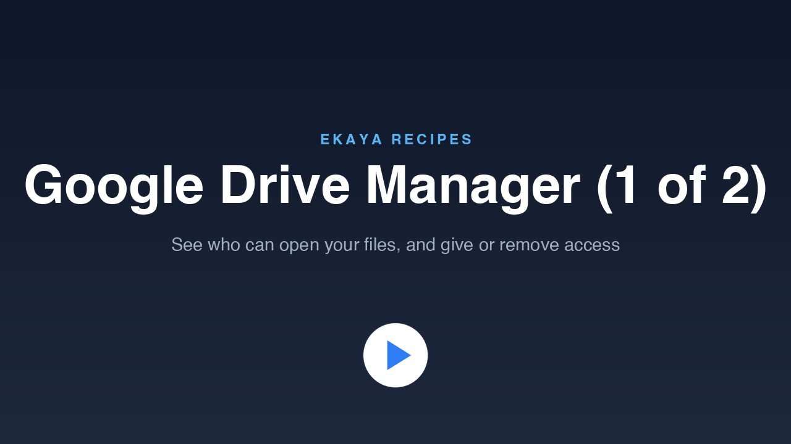

# Google Drive Manager (1 of 2): Viewing and Changing Permissions

See who has access to your Google Drive, and give or remove that access, from one page in your Ekaya project. You sign in with your own Google account once, your agent publishes the app, and you ask your agent in plain words to share a file or to take someone's access away.

[](https://cdn.ekaya.ai/recipes/google-drive-manager-permissions.mp4)

[Watch the video](https://cdn.ekaya.ai/recipes/google-drive-manager-permissions.mp4), about two minutes long, or [watch it in full resolution](https://cdn.ekaya.ai/recipes/google-drive-manager-permissions-1080p.mp4).

The app is called Google Drive Manager. It scans your Google Drive, My Drive and every shared drive, and lists each other person who has access, the files they can open, and their access level. By default it shows the files you share. A toggle adds the files shared with you.

Each person has a **Remove all access** button, and each file row has a **Remove access** button. Both ask you to confirm first. You can also tell your agent, for example, "share the Partner Overview document with someone@example.com as a viewer", or "remove Sam's access to these two folders and the Legal shared drive". Your agent finds the exact files, folders or shared drives, then opens the app on a confirm card.

This is part 1 of 2. Part 2 adds an Access log tab: see [Google Drive Manager (2 of 2)](../google-drive-manager-access-log/).

## Before you start

- Finish [Getting Started](../../getting-started/). You then have an Ekaya project, and your agent is connected to it.
- Be an Administrator of the project.
- Have a Google account whose Drive you want to review. Shared drives need Google Workspace.
- To share with people outside your organization, your Workspace's sharing settings must allow it. If they do not, Google refuses the share.

## What you will do

1. Paste the prompt below into your agent.
2. Open the link your agent gives you and sign in with Google. It is one click, and there are no keys to copy.
3. Your agent sets up read-only access to your Drive, plus two Requests that change sharing. It then publishes the app and gives you its link.
4. Open the app and click **Scan Drive**.
5. Try a share. Ask your agent to share a file with someone. When the confirm card opens, click **Decline** the first time to see that nothing changes. Then try a real share on a harmless file.
6. To remove access, use the buttons in the app, or ask your agent. It opens a confirm card for you.

## Things to know

- Scanning only reads names and sharing settings.
- For files in shared drives, the app reads each file's access one at a time, so a big drive takes longer. A progress bar shows how far it has got.
- Files shared with you outside a shared drive often come back without a sharing list. The page tells you how many.
- Folders in My Drive are listed with a "folder" label. Folders inside shared drives are not read one by one.
- Access that comes from a parent folder, or from a shared drive's membership, cannot be removed on the file itself. The card says so, and you remove it where it was set.
- An owner's access cannot be removed.
- Groups are listed as one entry and are not expanded into their members.
- Google emails the person an invitation when you share. Leave the notification box ticked: an address with no Google account may need it.
- Links shared with "anyone with the link", or with a whole domain, are counted but are not listed as people.
- Nothing changes until you click **Confirm** in the app. The app itself makes the change, and your agent only prepares the card.
- The app is for Administrators only. If you share the app with another Role, that Role can also give and remove access.

## Prompt

```text
Use Ekaya to set up the Google Drive Manager from this Recipe.
Follow the steps for agents in this Recipe:
https://github.com/ekaya-inc/ekaya-recipes/tree/main/applications/google-drive-manager-permissions
You may add Google Drive to my project, approve the read-only Drive
Requests and the two Requests that give and remove access, and
publish the app. Never share a file or remove anyone's access until
I confirm it in the app, and never ask me for passwords or keys.
```

## For your agent

These steps are for the AI agent that the prompt was pasted into. They assume that Ekaya's MCP server is connected and that the person is an Administrator of the project.

1. **Check access.** Call `describe_project`. Confirm the person can add datasources and publish apps. The app's slug is `google-drive-manager`.

2. **Add Google Drive.** Call `list_service_providers` with `q` set to "google drive" and use the Composio card `composio_googledrive`. It uses the person's own one-click Google sign-in, with no keys. Call `create_service_datasource` with name "Google Drive", the provider `composio_googledrive` and `credential_mode` `per_user`. Give the person the `human_link` it returns and ask them to sign in with Google. The link works once and expires; `request_connection_link` makes a new one. When they say they are done, call `get_datasource_connection`: the status should be `ready`, and that Administrator read also publishes the card's connector. Never ask for credentials in the conversation.

3. **Select the two write tools.** Call `get_connector_operations` and note the stored overlay revision (0 the first time). Call `search_connector_tools` with `q` set to "permission" to get the exact versions of `GOOGLEDRIVE_CREATE_PERMISSION` and `GOOGLEDRIVE_DELETE_PERMISSION`. Then call `select_connector_tools`, adding both, with `expected_revision` set to that revision. This republishes the connector and creates two pending Requests. Read Requests already on the card carry forward.

4. **Define the Requests.** `app/requests.json` in this folder defines the six read Requests and the two write Requests: name, operation, description, and parameters with defaults. Read it.

   - For each of the six read entries, call `suggest_approved_query` with `request_kind` "operation", the module `composio_googledrive`, the entry's operation, the `datasource_id`, and the entry's name, description and parameters. Pass the `artifact_hash` from `get_connector_operations`; read it again after step 3, because it changes.
   - For the two write entries, take the pending suggestions from `list_query_suggestions` and revise them in place with `revise_query_suggestion` to the name, description and parameters in `requests.json`. This removes the parameters that could share with a whole domain or "anyone", transfer ownership, or use admin access.
   - String parameters cannot carry an allowed-values list here. The description therefore states that `type` must be `user` or `group` and `role` must be `reader`, `commenter` or `writer`. The give-access Request does not itself reject type `anyone`, so you must never send it.

5. **Approve.** Call `approve_query_suggestion` with `effect_attestation` `READ` for the reads, `CREATE` for the give-access Request and `DELETE` for the remove-access Request. You may approve the two write Requests because the person consented in the prompt. Tell them plainly what each does: one gives a person access to a file, folder or shared drive, and the other removes it.

6. **Check.** Call `execute_approved_request` on the scan Request with `pageSize` 5, and on the who-is-signed-in Request. Each should return files, or the signed-in person, with outcome `succeeded`.

7. **Publish the app.** Replace each `REPLACE_*` placeholder in `app/index.html` with that Request's id; `requests.json` names the placeholder for each Request. Leave the Access log id (`audit`) empty. Then call `publish_app_version` with slug `google-drive-manager`, name "Google Drive Manager", a one-sentence description, the three files in `app/` (`index.html`, `share.js`, `theme.css`), and `requests` set to the eight Request ids. Use `strict_recording` true. The app starts as Administrators-only; leave it that way. If the project already has a shared theme app, you may link that instead of publishing `theme.css`.

8. **Hand over.** Give the person the app's URL and tell them to click **Scan Drive**.

9. **Share and remove from the conversation.** Use the confirm card only. Never call the give-access or remove-access Requests yourself.

   - To find items, run the scan Request with a `q` such as `name contains 'Partner Overview' and trashed = false` (or `fullText contains '...'`). List shared drives with the shared-drives Request. If more than one item matches, ask which. Read the drive id from `files[].driveId` and check `parents`.
   - Default to Viewer (`reader`) unless the person names a level.
   - Build the link on the app's URL. To share: `?share_to=EMAIL&role=reader|commenter|writer&files=ID,ID&drives=ID`, with `&notify=0` to turn off Google's email. To remove: `?remove_from=EMAIL&files=ID,ID&drives=ID`. `files=` takes file and folder ids, `drives=` takes shared drive ids, and at most 20 ids are allowed together.
   - Open the link for the person (on macOS: `open "URL"`) or give them the URL. They click **Confirm** or **Decline**.
   - Afterwards, read the item's permissions with the permissions Request to confirm the result. Do not rely on what the page showed.

10. **Notes.** If a person has not connected their own Drive, the app offers a sign-in link.
