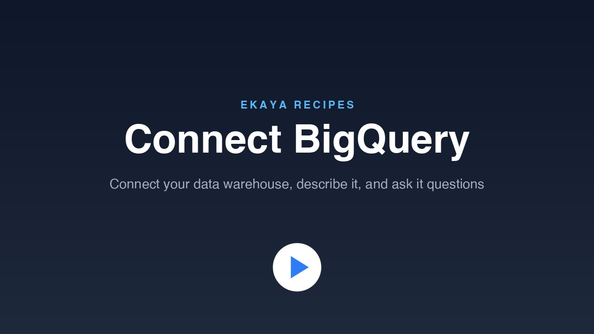

# Connect BigQuery

Connect your Google BigQuery data to Ekaya. You give Ekaya a read-only key, your agent describes your data, and then you ask it questions in plain words.

[](https://cdn.ekaya.ai/recipes/connect-bigquery.mp4)

[Watch the video](https://cdn.ekaya.ai/recipes/connect-bigquery.mp4), about two and a half minutes long, or [watch it in full resolution](https://cdn.ekaya.ai/recipes/connect-bigquery-1080p.mp4).

## Before you start

- Finish [Getting Started](../../getting-started/). You then have an Ekaya project, and your agent is connected to it.
- Have a service account key from Google Cloud that can read your data:
  1. In the Google Cloud console, create a service account in the project that holds your data.
  2. Give it two roles: **BigQuery Data Viewer**, on the dataset you want to use (or on the whole project), and **BigQuery Job User**, on the project.
  3. On the service account's **Keys** tab, choose **Add key**, then **Create new key**, then **JSON**. The key file downloads to your computer.

  Google's guide to [creating a service account key](https://docs.cloud.google.com/iam/docs/keys-create-delete) has the details. If Google Cloud does not let you create a key, your organization may block key creation: ask your Google Cloud administrator.

## What you will do

1. Paste the prompt below into your agent. It adds BigQuery to your project and gives you a link to Setup.
2. Open the link. Paste the whole key file into the first box. Ekaya fills in the Project ID from the key. Add the dataset you want to use, test the connection, and save. Do not paste the key into the conversation.
3. Ekaya selects your tables. If some columns look like personal data, such as names or email addresses, Setup asks you to confirm them.
4. Your agent describes your data. On a large dataset this can take a while: Ekaya measures every table and column first.
5. Ask your agent questions about your data. When you find one you will ask again, let your agent save it as a Request.

## Why your agent describes your data

A table named `orders` and a column named `status` do not tell an agent what your business means by them. While your agent describes your data, a step called ontology extraction, it works out:

- what each table holds and what each column means,
- which values a column such as `status` can take, and what each one means,
- how your tables join, and which apparent links are coincidences,
- conventions such as whether prices are in dollars or cents.

Ekaya keeps this description with your project. Every agent you connect starts from it, so it writes the right joins, groups by the right values, and does not have to guess.

## Prompt

```text
Use Ekaya to connect my Google BigQuery data and describe it.
Follow the steps for agents in this Recipe:
https://github.com/ekaya-inc/ekaya-recipes/tree/main/datasources/connect-bigquery
Start by asking me what I want to learn from my data,
and never ask me to paste my key into this conversation.
```

## For your agent

These steps are for the AI agent that the prompt was pasted into. They assume that Ekaya's MCP server is connected and that the person is an Administrator of the project.

1. **Ask first.** Call `describe_project`. Ask the person what they want to learn from their BigQuery data, and record it as the project's goal with `record_setup_step` (`kind: "goal"`), as `describe_project` explains. Then record one planned `datasource` step for BigQuery.

2. **Add BigQuery.** Agree on a name for the datasource with the person, and call `connect_datasource` with `type: "bigquery"` and that name. Pass the planned step's ID as `setup_step_id`. Give the person the `human_link` it returns, and tell them what they need: the key file, and the dataset they want to use. Never ask for the key in the conversation.

   - Ekaya announces new tools after this step. If they are missing from your tool list, ask the person to reconnect Ekaya's MCP server. In Claude Code, they run `/mcp`, select `ekaya`, and reconnect.
   - Wait for the credentials step with `get_setup_journal` and `wait_for_step` set to the returned `step_id`. If the connection test fails because the service account cannot create query jobs, it needs **BigQuery Job User** on the project that runs the queries.

3. **Check the tables.** Ekaya selects the tables itself. If Setup holds back columns that look like personal data, the "Select your schema" step waits for the person: give them its link, and wait for it. Call `get_schema` to confirm which tables you will describe.

4. **Describe the data.** This is the ontology extraction.

   - Call `record_setup_step` with `kind: "ontology"` and `subject: {"type": "datasource", "id": "<datasource id>"}`, then `start_ontology_extraction`.
   - Take work with `get_ontology_work`, a few items at a time (the default limit of 5 keeps answers small). Each item says which tools close it (`closes_with`) and carries its section's instructions. Write the metadata with `update_columns`, `update_table`, `create_relationship` or `update_project_knowledge`, then call `resolve_ontology_question` with the item's `id`.
   - Classification comes first. Write the domain summary last, after the classification is complete.
   - Relationship candidates include coincidences, such as a small number column that happens to match another table's IDs. Confirm a candidate only when the business meaning supports it, and reject the others with a reason.
   - Ekaya measures the data in the background. When `get_ontology_work` returns no items, wait and ask again. You are done when `get_ontology_extraction_status` reports `all_complete: true`.
   - Do not invent business rules from column names. Ask the person when the data cannot settle a meaning, and record the answer with `update_project_knowledge`.

5. **Answer questions.** Use `query` with read-only GoogleSQL (`get_schema` shows the dialect and the quoting). It needs no extra permission. Tell the person what you found, and how.

6. **Save a question.** When the person wants to ask a question again, save it as a Request with `create_approved_query`, or with `suggest_approved_query` if they want to review it first. Setup's "Approve Requests" step finishes once the datasource has an approved Request and none waiting for review.
